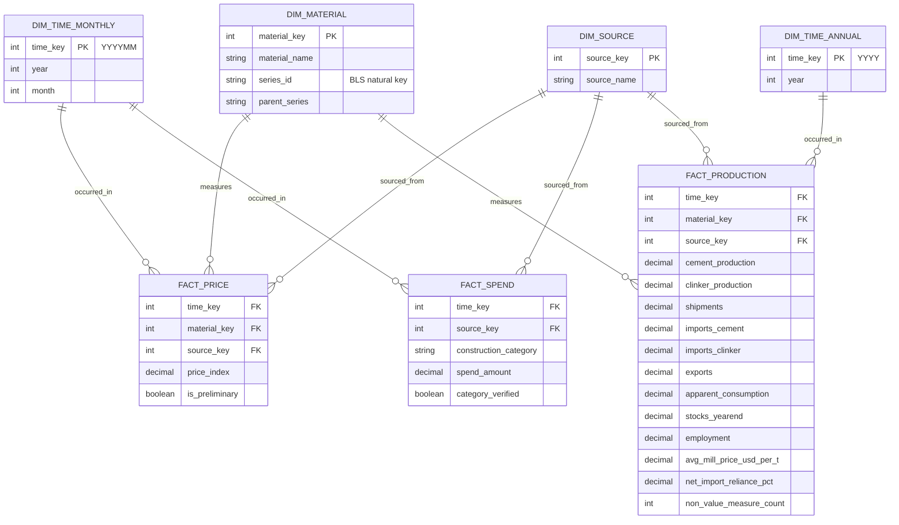

# Concrete & Cement Materials Market Pipeline

A portfolio data pipeline that lands three public U.S. construction-materials
sources in Snowflake and models them into a star schema: BLS producer price
indices, Census construction spending, and USGS cement production. The point of
the project is the reasoning rather than the volume — every design choice is
recorded with the alternative it beat in [`docs/data_sources.md`](docs/data_sources.md),
and the layers are deliberately thin enough that each transformation can be
explained in full.

## Repository layout

```
sql/        01-11, run in numeric order: RAW landing -> STAGING views -> MART
scripts/    fetch_*.py pull each source; upload_to_snowflake.py runs PUT + COPY INTO
            census_code_investigation/ holds one-off scripts used to infer Census codes
docs/       data_sources.md  decision log: every choice, the alternative it beat, the cost
            schema.md        column-level model and ERD
            project-plan.md  the original plan, kept as written to show what changed
data/       gitignored; fetched files land here
```

## Architecture

```
publisher API / file  ->  local JSON or CSV  ->  RAW  ->  STAGING  ->  MART
                          (scripts/)            tables   views       dimension
                                                                     tables +
                                                                     fact views
```

- **RAW** — what `COPY INTO` landed, minimally touched. JSON arrives in a single
  `VARIANT` column; the USGS CSV is typed entirely as `TEXT`. Append-only.
- **STAGING** — standard views that flatten, type, and route sentinel values.
  Views rather than tables, so a correction is an edit rather than a reload
  (Stage 5 Decision 1).
- **MART** — dimensions are **tables** (a surrogate key has to persist to mean
  anything), facts are **views** (they have no stored identity to protect).
  That split is Stage 5 Decision 4.

Every dimension carries an unknown member at key `-1`, and every fact view
`LEFT JOIN`s to it, so an unmatched row lands visibly against `Unknown` instead
of disappearing the way an `INNER JOIN` would drop it.

### Entity relationships



`dim_time_annual` and `dim_time_monthly` are deliberately **not** joined to each
other — correlate them on the shared `year` column. That makes it structurally
impossible to fan an annual USGS figure across monthly rows.

## Sources

| Source | Access method | Cadence | Grain |
|---|---|---|---|
| **BLS PPI** | REST API (JSON), v2 registered key | Monthly | National, one row per series per month |
| **Census VIP** | REST API (JSON), registered key | Monthly, two-month lag; prior months revised | National, one row per category per month |
| **USGS MCS** | CSV data release, public download, no key | Annual | National, one row per year per statistic |

Credentials are read from a local `.env` (gitignored). `.env.example` lists the
variable names.

## Run order

### 1. Create the objects — once

Run `sql/01` through `sql/04` in order. Together they create the warehouse, the
database, the `RAW` / `STAGING` / `MART` schemas, the three named internal
stages, two file formats, and the three RAW landing tables.

```
sql/01_setup_warehouse_db_schema.sql   Warehouse CONCRETE_PIPELINE_WH, database
                                       CONCRETE_PIPELINE, schemas RAW / STAGING / MART
sql/02_raw_bls_ppi_landing.sql         File format RAW.JSON_FORMAT, stage
                                       RAW.BLS_PPI_STAGE, table RAW.BLS_PPI_RAW
sql/03_raw_census_vip_landing.sql      Stage RAW.CENSUS_VIP_STAGE, table
                                       RAW.CENSUS_VIP_RAW (reuses RAW.JSON_FORMAT)
sql/04_raw_usgs_mcs_landing.sql        File format RAW.CSV_FORMAT, stage
                                       RAW.USGS_MCS_STAGE, table RAW.USGS_MCS_RAW
```

Every object uses `IF NOT EXISTS`, so re-running these is safe. The `COPY INTO`
statements in `sql/02`, `sql/03` and `sql/04` are **commented out** — they belong
to step 2, after a file has actually been staged.

### 2. Land each source

**BLS PPI**

```
python scripts/fetch_bls_ppi.py            -> data/bls_ppi/bls_ppi_<timestamp>.json
python scripts/upload_to_snowflake.py bls  -> PUT into @RAW.BLS_PPI_STAGE, then COPY INTO RAW.BLS_PPI_RAW
```

**Census VIP**

```
python scripts/fetch_census_vip.py                -> data/census_vip/census_vip_<timestamp>.json
python scripts/upload_to_snowflake.py census_vip  -> PUT into @RAW.CENSUS_VIP_STAGE, then COPY INTO RAW.CENSUS_VIP_RAW
```

The upload script takes the source name as its first argument (`bls` or
`census_vip`), picks the most recent JSON in that source's data directory unless
you pass a path as a second argument, and runs `PUT` followed by the matching
`COPY INTO` in one go.

**USGS MCS — manual, not scripted**

```
python scripts/fetch_usgs_mcs.py           -> data/usgs/usgs_mcs_<timestamp>.csv
```

Then upload that CSV into `RAW.USGS_MCS_STAGE` through Snowsight
(**Ingestion → Add Data → Load files into a stage**) and run the `COPY INTO`
that sits commented out in **`sql/04_raw_usgs_mcs_landing.sql`** (it selects
`$1`–`$12` positionally and adds `METADATA$FILENAME` as `source_file`).

`upload_to_snowflake.py` cannot do this: USGS has no entry in its `SOURCES`
map, and the script only globs `*.json` while the USGS release is a CSV.

### 3. Build STAGING and MART

Run `sql/05` through `sql/11` in numeric order.

```
sql/05_staging_usgs_mcs_cement.sql     STAGING view for USGS MCS (Cement, U.S.)
sql/06_mart_dimensions.sql             MART dimension tables -- run before any fact view is queried
sql/07_mart_fact_production.sql        MART fact view for USGS cement production
sql/08_staging_bls_ppi.sql             STAGING view for BLS PPI
sql/09_mart_fact_price.sql             MART fact view for BLS price index
sql/10_staging_census_vip.sql          STAGING view for Census VIP
sql/11_mart_fact_spend.sql             MART fact view for Census construction spend
```

`scripts/census_code_investigation/` holds one-off scripts used to infer the
Census category codes empirically; they are not part of the pipeline.

## Key decisions

Full reasoning, with the rejected alternative for each, is in
[`docs/data_sources.md`](docs/data_sources.md).

- **Dimensions as tables, facts as views** — a surrogate key must be stored to
  stay stable; a fact has no stored identity anything depends on, so as a view it
  tracks STAGING for free. (Stage 5 Decision 4)
- **Surrogate keys as explicit literals, not `AUTOINCREMENT`** — a sequence
  derives its value from insertion order, so a rebuild can silently reassign
  `material_key` 1 to a different material while every fact row still points at
  key 1. (Stage 5 Decision 6)
- **`fact_production` is eleven named measures, not one `production_volume`** —
  the source publishes eleven statistics at one grain under three different
  additivity rules. (Stage 5 Decision 3)
- **Sentinel values routed in STAGING, not filtered at ingest** — interpretation
  happens downstream where it can be corrected by an edit rather than a
  re-fetch. (Stage 5 Decision 2, with the MART summary column in Decision 8)
- **BLS release precedence: STAGING keeps every load, `fact_price` takes the
  latest** — append preserves history; the fact view decides which row wins.
  (Stage 5 Decision 9)
- **Census category derived from `category_code`, not the stamped label** — the
  code is what Census sent; the label is our interpretation of it, and an
  interpretation stored in RAW can only be fixed by re-fetching. (Stage 5
  Decision 13, with `category_verified` in Decisions 14 and 17)
- **All tables permanent** — transient tables skip Fail-safe and suit short-lived
  work tables; this project has none (STAGING is views) and the data is about
  3 MB. (Stage 5 Decision 16)

## Verification

Verification tables for each source are in
[`docs/data_sources.md`](docs/data_sources.md) under "Verification performed
(Stage 5 — USGS / BLS / Census / independent spot checks)". Counts recorded
there:

| Object | Rows | Grain uniqueness | Unknown-member rows |
|---|---|---|---|
| `stg_usgs_mcs_cement` | 55 | zero duplicates per year and statistic | — |
| `fact_production` | 5 (2021–2025) | — | — |
| `stg_bls_ppi` | 889 | zero duplicates within a single load | — |
| `fact_price` | 889 | `(time_key, material_key)` zero duplicates | zero |
| `stg_census_vip` | 378 | zero duplicates within a single load | — |
| `fact_spend` | 378 | `(time_key, construction_category)` zero duplicates | zero |
| dimensions | 6 / 133 / 8 / 4 (each includes `-1`) | zero duplicates | — |

Two limits that `data_sources.md` states explicitly and that are worth repeating
here:

- Regression values such as "Cement 2026-07 = 357.489" come **from the same pull
  as the data they test**, so they show the view reproduces RAW — **not** that
  RAW matches the publisher.
- The independent spot checks compared BLS `WPU1322` (cement) and all three
  landed Census categories against **FRED, a secondary source** that republishes
  BLS and Census series. BLS cement: 12 of 14 sampled months identical. Each
  Census category (Commercial, Power, Manufacturing): 124 of 126 months
  identical, with the differences confined to the two newest months. A direct
  comparison at bls.gov and census.gov remains a manual step that has not been
  done.

## Known limitations

- **No value has been compared by hand at bls.gov or census.gov.** Publisher
  verification is partly done via FRED's republication only: one of seven BLS
  series and the three Census categories. The other six BLS series and the USGS
  figures have not been compared against any outside source (open item 5).
- **Census categories are verified at the value level only.** All three landed
  categories match FRED's republication of the Census series in every settled
  month, and `category_verified` is `TRUE` on that basis (Stage 5 Decision 17).
  That is not the authoritative code table: the Economic Indicator Division's
  reply contradicts the inferred mapping for codes that are not landed, and the
  zipped VIP dataset remains the tiebreaker (open item 2, Census Decision 1).
- **`fact_spend` covers 3 of 4 categories and is not a total.** Highway and
  Street is not landed, pending resolution of its code (open item 2).
- **USGS release precedence is descoped.** RAW appends each annual release and
  releases overlap on four years, so a second load would put two rows in STAGING
  per year and statistic, and `fact_production` would silently take `MAX` across
  releases. No second release will be loaded for this project; verification
  check 5 in `sql/07_mart_fact_production.sql` fails the moment a duplicate
  appears (Stage 5 Decision 18).
- **The loaded USGS file is likely unchanged, but unconfirmed.**
  `MCS2026_Commodities_Data.csv` was loaded 2026-09-08. Its size, 3.04 MiB,
  matches the file ScienceBase currently lists, and its metadata date is
  2026-02-06. The data release page shows September 18, 2026, and what that date
  means is not known. Closing this means comparing the SHA-256 of a fresh
  download against the loaded file (open item 6).
- **`fact_price` precedence is untested on overlapping loads.** It runs correctly
  on a single load, which proves only that it does not damage a single-load
  result (known debt, Stage 5).
- **`dim_time_monthly` covers 2016-01 to 2026-12 via a hard-coded `ROWCOUNT`**
  that needs raising by 12 each year (known debt, Stage 5).
- **A `CASE` expression is duplicated** across a view and two commented
  diagnostics in `sql/05_staging_usgs_mcs_cement.sql`, and the `statistic_map`
  list exists twice in `sql/07_mart_fact_production.sql` (known debt, Stage 5).

## Not built yet

These were in the original plan and are deliberately left for a later pass:

- **Scheduled incremental refresh with Streams and Tasks.** Every load today is
  run by hand, which suits three sources that publish monthly or annually.
- **Role separation across RAW, STAGING and MART.** Every object is currently
  owned by `ACCOUNTADMIN`. That is acceptable on a single-user trial account and
  wrong anywhere else. The next step is a dedicated owner role for the pipeline,
  plus a read role per layer, so a BI user can read MART without touching RAW.
  The only scoped role today is a read-only verification role
  (`docs/data_sources.md`, open item 4).

## How this was built

I used Claude as a pair-programmer and tutor throughout. It explained Snowflake
concepts, drafted SQL and scripts for me to review, and ran read-only
verification queries through the scoped role above. The design decisions, the
alternatives rejected, and the verification calls are mine. Each one is logged
with its reasoning in [`docs/data_sources.md`](docs/data_sources.md).

## What I learned

> **TODO — to be written by the project author.** Left deliberately blank. This
> section is the "explain it back cold" artifact: write it without looking at the
> code, then check it against `docs/data_sources.md`. Anything you cannot explain
> is the part to revisit, not to paper over.
