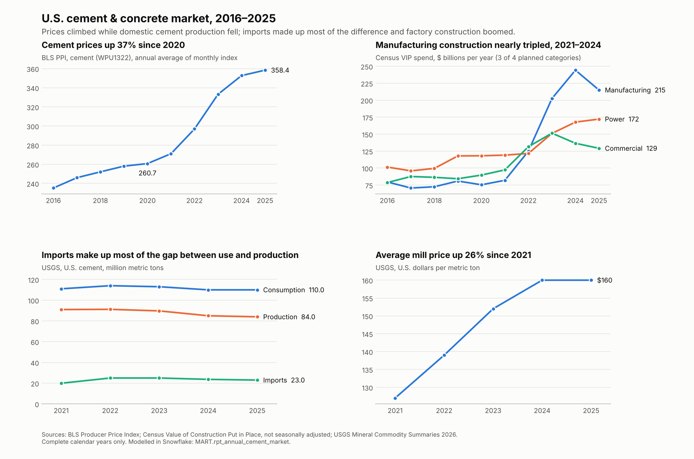
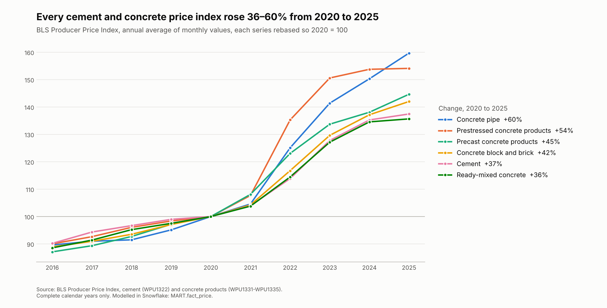

# Charts — U.S. Cement & Concrete Market

Two static charts built from the MART layer. They answer the question in the
original project plan: how cement and concrete prices, construction demand and
domestic production move relative to each other.





## How they are made

```
MART.rpt_annual_cement_market  ──┐
                                 ├── exported once ──> data/*.csv ──> render_charts.py ──> charts/*.png
MART.fact_price + dim_material ──┘
```

- **`data/annual_market.csv`**: `MART.rpt_annual_cement_market`, complete
  calendar years only (2016–2025). That view is the annual drill-across of all
  three sources (`sql/12_mart_reporting.sql`, Stage 6 Decision 1).
- **`data/annual_ppi_by_product.csv`**: annual averages of the monthly BLS
  index per series from `MART.fact_price`, 2016–2025.
- **`render_charts.py`**: reads only the CSVs, so anyone who clones the repo can
  reproduce the images without a Snowflake account (Stage 6 Decision 3).

The CSVs were checked against Snowflake before commit: every column's sum
matched the same sum computed in the warehouse.

### Regenerating

Export fresh snapshots with these two queries (in Snowsight, download each
result as CSV into `dashboard/data/`):

```sql
-- annual_market.csv
SELECT year,
       ROUND(cement_ppi_avg, 2)            AS cement_ppi_avg,
       ROUND(ready_mix_ppi_avg, 2)         AS ready_mix_ppi_avg,
       ROUND(concrete_products_ppi_avg, 2) AS concrete_products_ppi_avg,
       spend_commercial_musd::INT          AS spend_commercial_musd,
       spend_manufacturing_musd::INT       AS spend_manufacturing_musd,
       spend_power_musd::INT               AS spend_power_musd,
       cement_production_kt::INT           AS cement_production_kt,
       imports_cement_kt::INT              AS imports_cement_kt,
       apparent_consumption_kt::INT        AS apparent_consumption_kt,
       avg_mill_price_usd_per_t::INT       AS avg_mill_price_usd_per_t,
       net_import_reliance_pct::INT        AS net_import_reliance_pct
  FROM MART.rpt_annual_cement_market
 WHERE is_complete_year
 ORDER BY year;

-- annual_ppi_by_product.csv
SELECT t.year, m.series_id, m.material_name, ROUND(AVG(f.price_index), 2) AS ppi_avg
  FROM MART.fact_price f
  JOIN MART.dim_time_monthly t ON t.time_key = f.time_key
  JOIN MART.dim_material     m ON m.material_key = f.material_key
 WHERE t.year BETWEEN 2016 AND 2025
 GROUP BY 1, 2, 3
 ORDER BY 2, 1;
```

Then, from the repo root:

```
pip install matplotlib
python dashboard/render_charts.py
```

## Reading the charts

- **Price indices are rebased** in the second chart (each series' 2020 average =
  100), so the lines compare growth, not price levels. BLS indices for different
  products start from different bases and are not comparable as published.
- **Construction spend is three of four planned Census categories** and is not
  total construction spending. Highway and Street is not landed
  (`docs/data_sources.md`, open item 2).
- **USGS figures start in 2021**, the earliest year in the MCS 2026 release.
- **The current year is excluded.** 2026 is partial on both monthly sources;
  the view's `is_complete_year` flag filters it out.

## Next: Power BI

An interactive Power BI report is the next step, not yet built. The warehouse
side is in place: `MART.rpt_annual_cement_market` and the read-only
`MART_READER` role a BI tool connects with (`sql/12_mart_reporting.sql`,
Stage 6 Decision 2).
