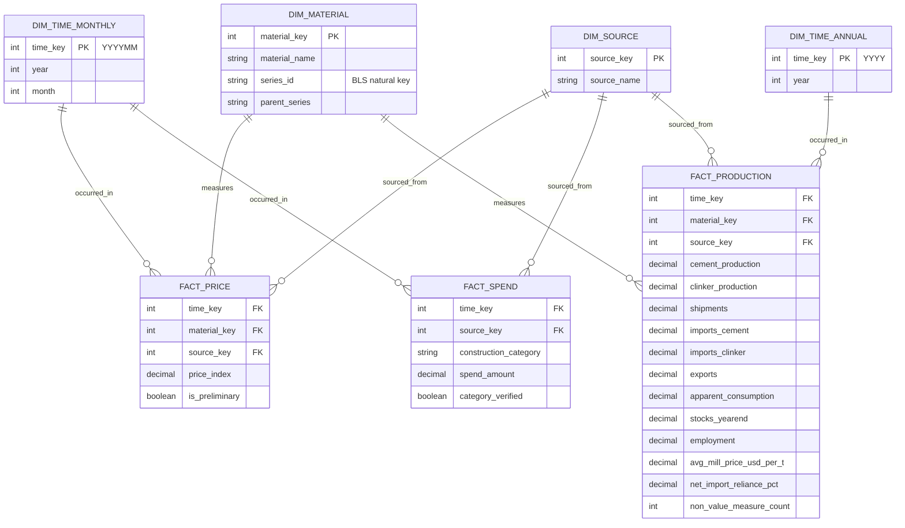

# Star Schema Design — Concrete & Cement Materials Market Pipeline

**Stage:** 5 — Transform
**Status:** Designed at Stage 3; revised at Stage 5 as the USGS, BLS and
Census slices were built. All three facts are now built. Objects marked **Built** exist in Snowflake and are verified. Objects
marked **Designed** are not yet built and may change when they are.
**Last updated:** 2026-10-02

This is the *what*. `docs/data_sources.md` holds the *why* — every choice below
traces to a numbered decision there.

---

## Design summary

- **Three fact tables**, split by what each source actually measures — not by
  source name, and not by cadence alone. (Stage 3 Decision 2)
- **Two time dimensions**, one per grain (monthly / annual), deliberately *not*
  connected to each other. This makes it structurally impossible to fan an
  annual value out across monthly rows. Sources are correlated by the `year`
  column both time dimensions carry, not by a shared table. (Stage 3 Decision 1)
- **No `dim_region`** — every source is national-level only. (Stage 3 Decision 3)
- **Census category as a degenerate dimension** directly on `fact_spend`.
  (Stage 3 Decision 4)
- **Hybrid storage: dimensions are tables, facts are views.** Surrogate keys must
  be stored to be stable; facts carry no identity anything depends on, so as
  views they stay current with STAGING and never need rebuilding.
  (Stage 5 Decision 4)
- **Every dimension has an unknown member at key `-1`**, and fact views
  `LEFT JOIN` to dimensions with `COALESCE(key, -1)`. An unmatched fact row lands
  visibly on `Unknown` instead of silently disappearing. (Stage 5 Decision 4)
- **Two key conventions, on purpose.** Time dimensions use a meaningful key —
  the year (`YYYY`) or year-month (`YYYYMM`). All other dimensions use opaque
  surrogate keys written as explicit literals in version-controlled SQL, so a
  rebuild reproduces identical keys. (Stage 5 Decision 6)
- **Snowflake does not enforce `PRIMARY KEY` or `FOREIGN KEY` constraints** —
  only `NOT NULL`. Declared keys are documentation. Uniqueness and referential
  integrity are verified by explicit checks in the SQL files.

---

## Dimension tables

### `dim_time_monthly` — Built (`sql/06_mart_dimensions.sql`)
| Column | Type | Notes |
|---|---|---|
| `time_key` | NUMBER(6,0) (PK) | **Year-month as an integer, `YYYYMM`** — e.g. `202403`. Not an opaque surrogate. |
| `year` | NUMBER(4,0) | Cross-grain correlation column shared with `dim_time_annual` |
| `month` | NUMBER(2,0) | 1–12 |

Rows: `-1` (unknown), then 132 months, 2016-01 through 2026-12. Generated from a
fixed start date and row count rather than typed as literals — the key is a pure
function of the date, so a rebuild reproduces it exactly. To extend, raise
`ROWCOUNT` by 12 per added year. (Stage 5 Decision 12)

### `dim_time_annual` — Built (`sql/06_mart_dimensions.sql`)
| Column | Type | Notes |
|---|---|---|
| `time_key` | NUMBER(4,0) (PK) | **The calendar year itself** — e.g. `2023`. Not an opaque surrogate. |
| `year` | NUMBER(4,0) | Duplicates `time_key` by value, deliberately: it is the documented cross-grain correlation column shared with `dim_time_monthly` |

Rows: `-1` (unknown), 2021–2025. A future USGS release adds rows here only.

### `dim_material` — Built (`sql/06_mart_dimensions.sql`)
| Column | Type | Notes |
|---|---|---|
| `material_key` | NUMBER(9,0) (PK) | Surrogate key, explicit literal |
| `material_name` | VARCHAR(100) | e.g. `Cement`, `Ready-mixed concrete` |
| `series_id` | VARCHAR(20) | **Added at Stage 5.** BLS natural key, e.g. `WPU1322`. NULL for the unknown member. |
| `parent_series` | VARCHAR(20) | BLS parent category, `WPU133`. NULL for `WPU133` itself — it is the parent. |

**Conformed** — shared by `fact_price` and `fact_production`.

| `material_key` | `material_name` | `series_id` | `parent_series` |
|---|---|---|---|
| -1 | Unknown | — | — |
| 1 | Cement | WPU1322 | WPU133 |
| 2 | Concrete block and brick | WPU1331 | WPU133 |
| 3 | Concrete pipe | WPU1332 | WPU133 |
| 4 | Ready-mixed concrete | WPU1333 | WPU133 |
| 5 | Precast concrete products | WPU1334 | WPU133 |
| 6 | Prestressed concrete products | WPU1335 | WPU133 |
| 7 | Concrete products | WPU133 | — |

`series_id` was added because `parent_series` is `WPU133` for all six child
materials and cannot identify which one a BLS row belongs to. Without it,
loading `fact_price` would require a string join against BLS series titles.
(Stage 5 Decision 5)

### `dim_source` — Built (`sql/06_mart_dimensions.sql`)
| Column | Type | Notes |
|---|---|---|
| `source_key` | NUMBER(9,0) (PK) | Surrogate key, explicit literal |
| `source_name` | VARCHAR(100) | MART-layer lineage |

Rows: `-1` Unknown · `1` BLS PPI · `2` Census VIP · `3` USGS MCS.

---

## Fact tables

### `fact_production` (USGS MCS — annual) — Built (`sql/07_mart_fact_production.sql`)

**Grain: one row per year per material.** One named column per USGS statistic,
each with a single unit and a single additivity rule. A **view** over
`STAGING.STG_USGS_MCS_CEMENT`, pivoted by conditional aggregation.
(Stage 5 Decisions 3, 4, 7)

| Column | Unit | Additivity | Notes |
|---|---|---|---|
| `time_key` | — | — | FK → `dim_time_annual`. Holds the year. |
| `material_key` | — | — | FK → `dim_material`. Constant `1` (Cement) today. |
| `source_key` | — | — | FK → `dim_source`. Constant `3` (USGS MCS) by construction. |
| `cement_production` | thousand metric tons | Additive | **Never add to `clinker_production`** — clinker becomes cement |
| `clinker_production` | thousand metric tons | Additive | See above |
| `shipments` | thousand metric tons | Additive | Includes exports |
| `imports_cement` | thousand metric tons | Additive | Hydraulic cement |
| `imports_clinker` | thousand metric tons | Additive | |
| `exports` | thousand metric tons | Additive | Cement and clinker combined |
| `apparent_consumption` | thousand metric tons | Additive | Pairs with Census VIP spend |
| `stocks_yearend` | thousand metric tons | **Semi-additive** | A balance — do not sum across years |
| `employment` | headcount | **Semi-additive** | Do not sum across years |
| `avg_mill_price_usd_per_t` | USD per metric ton | **Non-additive** | Cross-check against BLS `WPU1322` |
| `net_import_reliance_pct` | percent | **Non-additive** | |
| `non_value_measure_count` | count | — | Measures in this row whose source value was not a plain number. `0` = all clean. Otherwise check STAGING `value_flag`. (Stage 5 Decision 8) |

**No `production_key`.** The Stage 3 design gave each fact a surrogate primary
key. A view stores nothing, so a generated key would be recomputed on every read
and could not be referenced stably. The grain `(time_key, material_key)` is the
row's identity and is enforced by a verification check. (Stage 5 Decision 4)

Units and additivity are also attached as Snowflake column `COMMENT`s on the
view, so they are visible in Snowsight without this file.

### `fact_price` (BLS PPI — monthly) — Built (`sql/09_mart_fact_price.sql`)

**Grain: one row per month per material.** A **view** over
`STAGING.stg_bls_ppi`: monthly periods only, and where a month appears in more
than one load, the row from the most recent `loaded_at` wins.
(Stage 5 Decisions 4, 9, 11)

| Column | Type | Notes |
|---|---|---|
| `time_key` | NUMBER (FK) | → `dim_time_monthly` (`YYYYMM`) |
| `material_key` | NUMBER (FK) | → `dim_material`, resolved via `series_id` |
| `source_key` | NUMBER (FK) | → `dim_source`. Constant `1` (BLS PPI) by construction |
| `price_index` | NUMBER(38,6) | **Non-additive** — an index value. NULL only if BLS sent a non-number; check STAGING `value_flag` |
| `is_preliminary` | BOOLEAN | TRUE for BLS's latest four months, which BLS may revise. (Stage 5 Decision 10) |

**No `price_key`.** The Stage 3 design gave each fact a surrogate key. For the
same reason as `production_key`, a view cannot hold one; the grain
`(time_key, material_key)` is the row's identity, enforced by a verification
check. (Stage 5 Decision 4)

Today: 889 rows (7 series × 127 months, 2016-01 to 2026-07), 28 of them
preliminary.

### `fact_spend` (Census VIP — monthly) — Built (`sql/11_mart_fact_spend.sql`)

**Grain: one row per month per construction category.** A **view** over
`STAGING.stg_census_vip`: monthly rows only, and where a month appears in more
than one load, the row from the most recent `loaded_at` wins.
(Stage 5 Decisions 4, 9, 11, 13–15)

| Column | Type | Notes |
|---|---|---|
| `time_key` | NUMBER (FK) | → `dim_time_monthly` (`YYYYMM`) |
| `source_key` | NUMBER (FK) | → `dim_source`. Constant `2` (Census VIP) by construction |
| `construction_category` | VARCHAR | Degenerate dimension. **Commercial, Manufacturing, Power** today. `Unknown` = a code not in the STAGING map. Derived from `category_code` in STAGING, not read from the label stamped at load. (Stage 5 Decision 13) |
| `spend_amount` | NUMBER(38,6) | Millions of dollars, **not seasonally adjusted**. **Additive** across months and categories — but see below. |
| `category_verified` | BOOLEAN | FALSE while the code-to-category mapping is an unverified inference. FALSE on every row today. (Stage 5 Decision 14) |

**Not a total.** Highway and Street is not landed, so summing across categories
gives the spend of three categories, not total construction spending.

**No `spend_key`, no `material_key`.** A view cannot hold a surrogate key
(Stage 5 Decision 4), and Census spending is by construction type, not material,
so it cannot join `dim_material`. It meets BLS and USGS through time.

Highway and Street is not landed: its code is the disputed one
(`data_sources.md` open item 2). Adding it is one line in the STAGING map plus a
load.

Today: 378 rows (3 categories × 126 months, 2016-01 to 2026-06).

---

## Entity relationship diagram

GitHub renders the block below as a diagram on any markdown page in the repo. To
preview before pushing, paste the contents (without the fence) into
[mermaid.live](https://mermaid.live).

---

## Changes since the Stage 3 design

| Change | Reason | Decision |
|---|---|---|
| `dim_time_annual.time_key` holds the year; `dim_time_monthly.time_key` holds `YYYYMM` | A calendar year cannot be renamed, reused or retired, so there is nothing for a surrogate to insulate against | Stage 5 D6 |
| `dim_material` gains `series_id` | `parent_series` cannot distinguish the six child materials | Stage 5 D5 |
| Every dimension gains an unknown member at `-1` | Fact views `LEFT JOIN` to dimensions; an `INNER JOIN` would drop unmatched rows silently | Stage 5 D4 |
| `fact_production`: eleven named measures replace `production_volume` | The source publishes eleven statistics at one grain with three different additivity rules | Stage 5 D3 |
| `fact_production` gains `non_value_measure_count` | A NULL measure must not be mistakable for clean data | Stage 5 D8 |
| `production_key` removed | A view cannot hold a stable surrogate key | Stage 5 D4 |
| `fact_price` built as a view; no `price_key` | Same reasoning as `production_key` — a view cannot hold a stable surrogate | Stage 5 D4 |
| `fact_price` gains `is_preliminary` | A preliminary index value and a final one are indistinguishable as numbers | Stage 5 D10 |
| `fact_price` grain resolves overlapping BLS pulls by latest load | BLS revises recent months, so overlapping pulls are the normal case | Stage 5 D9 |
| `dim_time_monthly` generated from fixed bounds, not literals | Key is a pure function of the date, so a rebuild is still deterministic | Stage 5 D12 |
| `fact_spend` built as a view; no `spend_key` | Same reasoning as `production_key` — a view cannot hold a stable surrogate | Stage 5 D4 |
| `fact_spend` holds three categories, not four | Highway and Street is not landed; its code is the disputed one | Census D1–D2 |
| `construction_category` derived from `category_code` in STAGING | The label was stamped at load from an inference; the code is what Census sent | Stage 5 D13 |
| `fact_spend` gains `category_verified` | The code-to-category mapping has not been checked against a source of record | Stage 5 D14 |