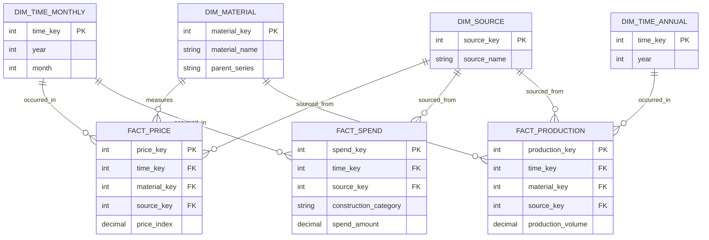

# Star Schema Design — Concrete & Cement Materials Market Pipeline

**Stage:** 3 — Data Mapping (schema definition)
**Status:** Locked, pending validation at Prototype stage

This is the resulting structure from the Stage 3 decisions logged in `data_sources.md`. Read that file for the *why* behind each choice; this file is the *what*.

---

## Design summary

- **Three fact tables**, split by what each source actually measures — not by source name, and not by cadence alone.
- **Two time dimensions**, one per grain (monthly / annual), deliberately *not* connected to each other — this makes it structurally impossible to accidentally fan-out an annual value across monthly rows. Sources are correlated by the `year` column each time dimension carries, not by a shared table.
- **No `dim_region`** — every source is national-level only.
- **One Census category stored as a degenerate dimension** directly on `fact_spend`, rather than a separate table, since it's four fixed, non-reused values.

---

## Dimension tables

### `dim_time_monthly`
| Column | Type | Notes |
|---|---|---|
| `time_key` | int (PK) | Surrogate key |
| `year` | int | Shared join value with `dim_time_annual` |
| `month` | int | 1–12 |

### `dim_time_annual`
| Column | Type | Notes |
|---|---|---|
| `time_key` | int (PK) | Surrogate key |
| `year` | int | Shared join value with `dim_time_monthly` |

### `dim_material`
| Column | Type | Notes |
|---|---|---|
| `material_key` | int (PK) | Surrogate key |
| `material_name` | string | e.g. "Cement", "Ready-mixed concrete" |
| `parent_series` | string | Parent category, e.g. `WPU133` |

### `dim_source`
| Column | Type | Notes |
|---|---|---|
| `source_key` | int (PK) | Surrogate key |
| `source_name` | string | BLS PPI / Census VIP / USGS MCS — lineage tracking |

---

## Fact tables

### `fact_price` (BLS PPI — monthly)
| Column | Type | Notes |
|---|---|---|
| `price_key` | int (PK) | |
| `time_key` | int (FK) | → `dim_time_monthly` |
| `material_key` | int (FK) | → `dim_material` |
| `source_key` | int (FK) | → `dim_source` |
| `price_index` | decimal | |

### `fact_spend` (Census VIP — monthly)
| Column | Type | Notes |
|---|---|---|
| `spend_key` | int (PK) | |
| `time_key` | int (FK) | → `dim_time_monthly` |
| `source_key` | int (FK) | → `dim_source` |
| `construction_category` | string | Degenerate dimension — Commercial / Manufacturing / Power / Highway and Street |
| `spend_amount` | decimal | |

### `fact_production` (USGS MCS — annual)
| Column | Type | Notes |
|---|---|---|
| `production_key` | int (PK) | |
| `time_key` | int (FK) | → `dim_time_annual` |
| `material_key` | int (FK) | → `dim_material` |
| `source_key` | int (FK) | → `dim_source` |
| `production_volume` | decimal | |

---

## Entity relationship diagram

GitHub renders the block below automatically as a diagram on any markdown page in the repo — no extra tooling needed once this is pushed. To preview it before pushing, paste the code block (without the surrounding \`\`\`mermaid fence) into [mermaid.live](https://mermaid.live), or install the "Markdown Preview Mermaid Support" extension in VS Code.

---

## Open items carried into Prototype

1. Confirm Census `category_code` literal values via live authenticated API call (see `data_sources.md`).
2. Validate this schema against a couple of known periods once real data is loaded (Stage 5, Test/Calibrate).
